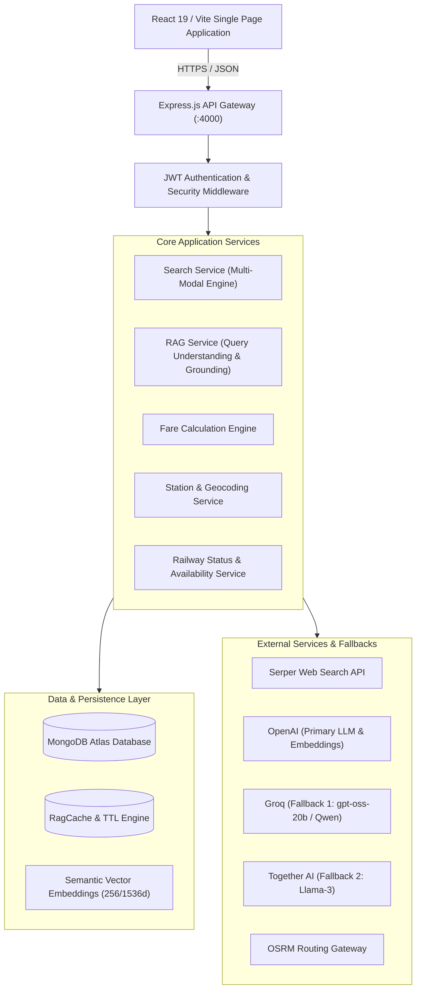
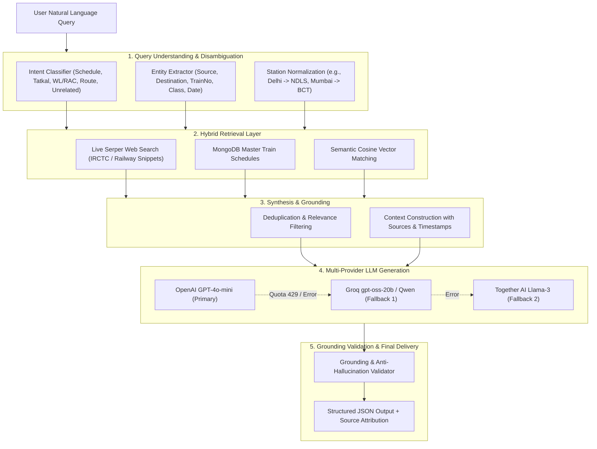

# RouteWise — Architecture & Engineering Specification

This document details the architectural design, system boundaries, RAG pipeline, data models, and resilience strategies implemented in **RouteWise**.

---

## 1. System Overview

RouteWise is a full-stack multi-modal transport discovery, fare comparison, and route optimization platform for India. It integrates local databases with Retrieval-Augmented Generation (RAG) across live web search and Large Language Models (LLMs).

---

## 2. Retrieval-Augmented Generation (RAG) Architecture

The RouteWise RAG pipeline is engineered with multi-stage query understanding, intent classification, station disambiguation, hybrid retrieval (live web + MongoDB vector search), context synthesis, multi-provider LLM fallback, and strict anti-hallucination grounding validation.

---

## 3. Intelligent Caching Strategy

RouteWise utilizes a tiered caching architecture to maintain high throughput while ensuring data freshness:

| Category | Storage Engine | Freshness / TTL | Invalidation Strategy |
|:---|:---|:---|:---|
| **RAG Queries** | MongoDB `RagCache` | 24 Hours TTL | Query MD5 Hash + Automatic TTL Index |
| **Train Searches** | MongoDB `RagCache` | 24 Hours TTL | Origin + Destination + Date + Class key |
| **Seat Availability** | In-Memory `Map` | 5 Minutes | Memory TTL expiry (`expiresAt`) |
| **Live Train Status** | RAG Web Search | Real-Time | Evaluated on-demand per train and date |
| **Station Master Catalog** | MongoDB `Station` | Static / Persistent | Refreshed during database ingestion |
| **Embeddings** | In-Memory `Map` + DB | Persistent | Cached by exact string representation |

---

## 4. Multi-Modal Transport Comparison Engine

The transport comparison engine evaluates multiple travel modes concurrently:

1. **Train**: Directly queries `Train` and `TrainSchedule` models, applying class-specific base fares, reservation charges, superfast surcharges, GST, and Tatkal formulas.
2. **Bus**: Compares operator schedules, amenities, seat availability, and driver assignments.
3. **Taxi**: Computes distance-based estimates based on vehicle class (Hatchback, Sedan, SUV) and driver proximity.
4. **Carpool**: Matches shared community rides with atomic reservation concurrency control.
5. **Own Vehicle (Fuel)**: Estimates fuel expenditure using distance metrics and average fuel efficiency assumptions.

### Routing Scoring Algorithm:
$$\text{Score} = w_{\text{fare}} \cdot S_{\text{fare}} + w_{\text{time}} \cdot S_{\text{time}} + w_{\text{eco}} \cdot S_{\text{eco}}$$

Where:
- $S_{\text{fare}}$ prioritizes lowest financial cost
- $S_{\text{time}}$ prioritizes lowest transit duration
- $S_{\text{eco}}$ prioritizes lowest estimated $\text{CO}_2$ emissions per passenger-kilometer

---

## 5. Security & Reliability Engineering

- **Helmet**: Secures HTTP response headers against clickjacking, cross-site scripting, and sniffing.
- **In-Memory Rate Limiting**: Dedicated rate limiters protect authentication (10 req/min) and geocoding endpoints (60 req/min).
- **JWT Authentication**: High-entropy signed tokens with 7-day expiration and bcrypt password hashing (10 salt rounds).
- **Graceful OSRM Degradation**: If public routing servers time out or fail, RouteWise automatically falls back to Haversine geodesic distance calculation without user interruption.
- **Honest Provider Adapters**: Official railway APIs requiring enterprise credentials (such as live PNR status or RTIS GPS gateways) report honest integration status instead of fabricated simulation data.
